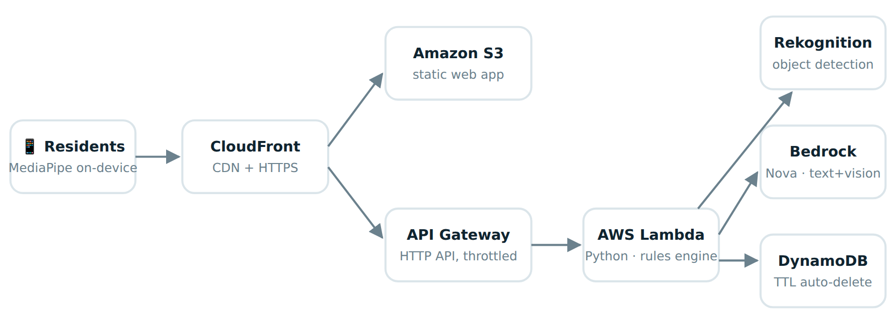
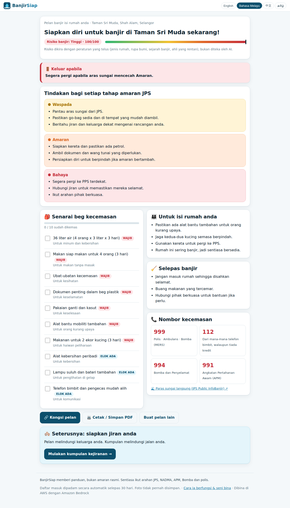
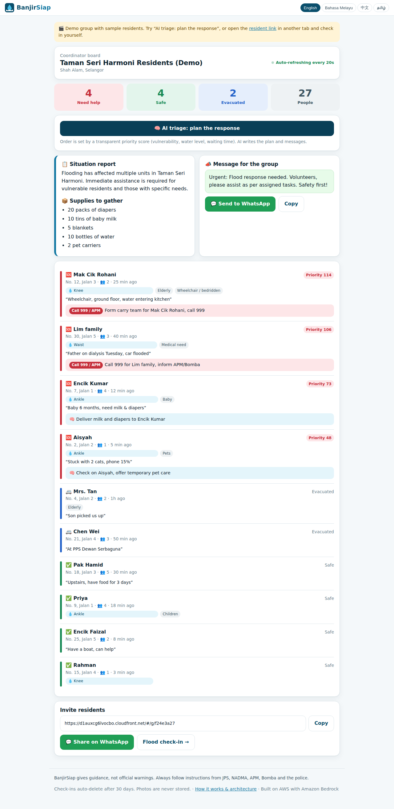
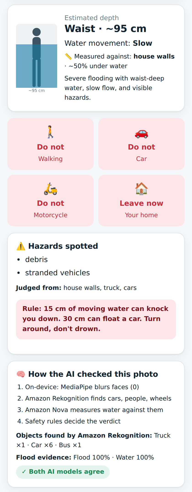

# 🌧️ BanjirSiap — Ready before the flood. Together after it.

**AWS Zero to Shipped hackathon entry** · Category: `#social-good` (Climate resilience) · Lane: `#community`

- **Live app:** https://d1auxcg6lvocbo.cloudfront.net
- **Project write-up:** [AWS Builder Center post](https://builder.aws.com/project/3K88SD2wDGEfUrVSzNRwm4wlagx/banjirsiap-ai-flood-readiness-and-neighbourhood-rescue-coordination-for-malaysia) · full text in [`docs/SUBMISSION.md`](docs/SUBMISSION.md)

BanjirSiap ("flood-ready" in Malay) helps Malaysian families and residents' associations prepare for and coordinate during floods. It works in **English, Bahasa Melayu, 中文 and தமிழ்**.

| Feature | What it does |
|---|---|
| 📋 **My Flood Plan** | 6 tap-to-answer questions produce a personal plan: a rule-based risk score, a "leave when…" trigger, actions for each JPS alert level (Waspada → Amaran → Bahaya), and a go-bag checklist sized to the household |
| 🏘️ **Neighbourhood Check-in** | One link for an RT/JMB WhatsApp group. Residents tap Safe / Need help / Evacuated. Coordinators get a live board ranked by a transparent priority score, plus **AI triage**: a situation report, volunteer actions, escalations and a WhatsApp broadcast |
| 📸 **Photo Water Check** | **MediaPipe** blurs faces on the phone → **Amazon Rekognition** finds reference objects (cars, wheels, people) → **Amazon Nova** measures water depth against their known heights. Fixed safety rules decide whether it's OK to walk, drive or ride |

> Try the **"Try the live demo board"** button on the home page, then press **AI triage**.

## Architecture



Fully serverless, defined in one SAM/CloudFormation template:

- **Amazon CloudFront** → **Amazon S3** for the static app, and → **API Gateway (HTTP API)** → **AWS Lambda** (Python 3.12, arm64)
- **Amazon Bedrock** (Amazon Nova Pro, fallback Nova Lite) for text and vision
- **Amazon Rekognition** for object detection
- **Amazon DynamoDB** (TTL auto-delete) for data
- **MediaPipe Tasks Vision** (WebAssembly) runs on-device in the browser for face blurring

**Design rule:** *rules decide, AI explains.* Risk scores, triage order, escalations and walk/drive verdicts come from deterministic code. The AI personalises, summarises and measures.

## Screenshots

| Plan (Bahasa Melayu) | Coordinator board + AI triage | Photo check result |
|---|---|---|
|  |  |  |

The proof that the coding agent worked with AWS through the AWS CLI is in [`docs/screenshots/08-proof-agent-aws-cli.png`](docs/screenshots/08-proof-agent-aws-cli.png).

## Repository layout

```
template.yaml            # the whole AWS stack (SAM / CloudFormation)
deploy.sh                # one-command deploy
backend/app.py           # Lambda: router, rules engine, Bedrock + Rekognition calls
frontend/                # index.html, app.js, i18n.js (4 languages), styles.css
scripts/local_server.py  # offline dev server (moto DynamoDB + fake Bedrock)
docs/                    # write-up, architecture, screenshots
```

## Deploy it yourself

Prerequisites: AWS CLI v2 signed in, an account with Amazon Bedrock (Nova) and Rekognition access in `us-east-1`.

```bash
./deploy.sh                                   # creates the stack, uploads the site, prints the live URL
MODEL_ID=us.amazon.nova-pro-v1:0 ./deploy.sh  # pick the Bedrock model
```

To run locally without AWS (DynamoDB and Bedrock are mocked):

```bash
pip install boto3 moto
python3 scripts/local_server.py 8080          # open http://localhost:8080
```

To tear it down: empty the site bucket, then run `aws cloudformation delete-stack --stack-name banjirsiap --region us-east-1`.

## Built with an AI coding agent

Built by Shermaine Yap with **Claude** as the coding agent, connected to AWS through the AWS CLI. The agent did the planning, infrastructure-as-code, backend, the four-language frontend, local tests, deployment and live debugging. See section 4 of [`docs/SUBMISSION.md`](docs/SUBMISSION.md).

*BanjirSiap gives guidance, not official warnings. Always follow JPS, NADMA, APM, Bomba and police instructions.*

## License

MIT, see [LICENSE](LICENSE).
